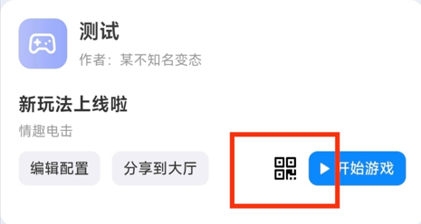

# 役次元 Tencent IM 控制协议

## 规范前言

由于设备类型丰富，协议采用 **事件 ID 驱动的通用控制结构**。
每个事件以唯一的 `id` 标识，并根据设备类型关联特定的**默认参数模板**。用户可对模板参数自定义并设置安全阈值。

**操作步骤**

- 开发者在役次元app内创建游戏并填写配置
- 开发者编写联动教程并分享二维码
- 玩家扫描役次元app分享的游戏二维码
- 用户手动修改配置并保存
- 用户在役次元app启动游戏并向第三方游戏提供uid和token
- 游戏连接IM
- 发送后续指令

**如何发送指令**

每一段指令都需要**JSON 对象序列化成字符串**后填入腾讯 IM 消息包中`payload.text`

建议先查看役次元IM基础协议 [IM_basic.md](IM_basic.md) 

遇到问题请先查看 [troubleshooting.md](troubleshooting.md) 和  [ycy_im_demo.ts](ycy_im_demo.ts) 

**用户体验优化规范**

- 简化用户填写「连接码」（UID 和 Token）的过程
  - 从 app 内启动游戏网页（填写了启动地址）时会通过 GET 参数传递`connect_code`，直接读取get参数即可，无须要求用户输入。
  - 原`uid`和`token`在app已合并为“连接码”。此设计目标为让用户只需复制粘贴一次并避免专业术语。
  - 可以缓存连接码，但当存在 GET 参数`connect_code`时应当替换缓存。例如将游戏保存到“我的游戏”中后连接码会改变。

------

## 在APP中创建游戏规范说明

### 游戏基础信息

| 字段名     | 类型   | 必填 | 说明                                                         |
| ---------- | ------ | ---- | ------------------------------------------------------------ |
| 游戏唯一码 | string | ✅    | 游戏唯一识别码。建议填写可验证的信息，后续涉及创作激励计划，例如`qq.123456789.minecraft`；`com.github.username.minecraft`；`ycy.<役次元id>.xxx` |
| 游戏名称   | string | ✅    | app端展示的游戏名称                                          |
| 启动地址   | string | ❌    | 设置后点击”开始游戏“自动打开网页并通过GET参数传递`uid`和`token` |
| 游戏教程   | string | ✅    | 游戏主页或教程地址，可以填写飞书文档后续动态更新。在役次元app点击“查看教程”所跳转到的页面 |
| 游戏作者   | string | ✅    | app内各种地方显示游戏的作者                                  |
| icon       | string | ❌    | 游戏图标。缺省使用默认 logo 代替。                           |

### 指令配置

指令名称：给用户理解的，例如：“超远程击杀”

指令ID：方便发送指令的，例如：“kill_2"

选择玩具和对应指令：用户获取到配置后的默认配置，用户可自行提升，建议电击强度在15~40

分享配置：”我的游戏“页面，点击”启动游戏“旁的二维码图标生成二维码，将二维码粘贴进教程文档，用户扫描后即可获得配置。

## 分享配置二维码

电击开始游戏按钮旁的二维码图标获取配置分享二维码，用户扫描后可一键保存配置



## 第三方扫码连接

先在 App 创建游戏，取得游戏唯一码 `game_code`。每次扫码连接按以下顺序操作。

### 1. 生成二维码

第三方为本次连接生成新的 UUID v4 `connect_id`。二维码扫码内容必须是原始 JSON 字符串：

```json
{
  "type": "game_connect",
  "connect_id": "550e8400-e29b-41d4-a716-446655440000",
  "game_code": "third_game_1001"
}
```

`type` 固定为 `game_connect`，`game_code` 换成实际游戏唯一码。JavaScript ES module 示例（使用 `qrcode` 库）：

```sh
npm install qrcode
```

```js
import QRCode from 'qrcode';

const connectId = crypto.randomUUID();
const gameCode = 'third_game_1001';
const qrText = JSON.stringify({
  type: 'game_connect',
  connect_id: connectId,
  game_code: gameCode,
});
const qrImageUrl = await QRCode.toDataURL(qrText);
```

保留本次的 `connectId`、`gameCode` 和 `qrImageUrl`。每次连接重新生成 UUID；浏览器使用 `crypto.randomUUID()` 需要 HTTPS 环境。

### 2. 注册连接

**展示二维码前**，用本次的 `connectId` 和 `gameCode` 调用一次 `query`：

`POST https://suo.jiushu1234.com/api.php/game_auth/query`

```json
{
  "connect_id": "550e8400-e29b-41d4-a716-446655440000",
  "game_code": "third_game_1001"
}
```

注册成功后，等待扫码的响应示例：

```json
{
  "code": 1,
  "msg": "等待扫码",
  "data": {
    "status": "pending",
    "expires_in": 178,
    "retry_after_ms": 2000
  }
}
```

`expires_in` 是剩余秒数，会随时间减少；`retry_after_ms` 是建议轮询间隔，单位为毫秒。

### 3. 展示二维码并轮询

收到 `data.status: pending` 后，才将 `qrImageUrl` 赋给页面 `` 元素的 `src`。用户在 App 扫码期间，用同一组 `connect_id` 和 `game_code` 按 `retry_after_ms` 间隔继续调用 `query`。

扫码成功的响应示例：

```json
{
  "code": 1,
  "msg": "连接成功",
  "data": {
    "status": "connected",
    "uid": "123456",
    "token": "<游戏 Token>"
  }
}
```

收到 `connected` 后保存 `uid` 和 `token`，停止轮询。示例中的 `uid` 和 `token` 仅用于展示字段格式。

连接过期的响应示例：

```json
{
  "code": 1,
  "msg": "连接已过期",
  "data": {
    "status": "expired"
  }
}
```

收到 `expired` 后停止轮询，重新生成连接 ID 并从第 1 步开始。扫码等待时间为 **180 秒**，轮询不会续期。扫码成功后，凭证可通过 `query` 领取 **60 秒**。

失败时 `code: 0`，原因见 `msg`，`data` 为对象。例如：

```json
{
  "code": 0,
  "msg": "游戏不存在",
  "data": {}
}
```

### 4. 连接 IM 并发送指令

使用领取的原始 `uid` 和游戏 `token` 调用 `POST https://suo.jiushu1234.com/api.php/user/game_sign`，取得腾讯 IM 的 `appid`、`sign`。扫码领取的游戏 Token 也是 IM 指令消息中的 `token` 字段。

扫码后默认游戏连接页接收 `game_info`（`data` 为游戏指令序号，从 0 开始）；进入指令连接页后，使用下文的 `game_cmd` 和指令 ID。两种消息都需携带本次游戏 Token。

当前扫码接口仅供联调，正式接入以平台开放通知为准。

## 发送执行指令

连接码以空格分割，空格后的部分即为token

```
{
  "code": "game_cmd",
  "id": "hurt",
  "token": "用户token，不含uid"
}
```

后续若无明确说明，所有指令均需要`token`参数。

## 自定义指令参数（正在开发）

### 电击器

**示例**

```
{
  "code": "game_cmd",
  "id": "类型为情趣电击的指令ID",
  "payload": {
    "reset_strength": true,
    "waveform": "波形名称"
  }
}
```

**字段说明**

| 字段名                   | 类型    | 是否必填 | 说明                                                       |
| ------------------------ | ------- | -------- | ---------------------------------------------------------- |
| `code`                   | string  | ✅        | 固定为 `game_cmd`                                          |
| `id`                     | string  | ✅        | 情趣电击器指令 ID                                          |
| `payload`                | object  | ❌        | 指令参数对象，可完全缺省，缺省时执行设置的放电和强度递增   |
| `payload.reset_strength` | boolean | ❌        | 为`true`时重置强度递增值（重置为初始强度），此次指令不放电 |
| `payload.waveform`       | string  | ❌        | App内置的波形名称，若不存在则使用游戏配置的波形            |

## 全局指令（正在开发）

**停止**

立即停止所有设备正在执行的指令。

```
{
  "code": "game_cmd",
  "id": "_stop_all",
}
```

**自定义波形与强度（草稿，暂缓开发）**

```
{
  "code": "game_cmd",
  "id": "_estim_custom_waveform",
  "payload": {
  
  }
}
```

## 更新游戏事件定义（暂缓开发）

将游戏metadata装入IM的`payload.text`中发送

